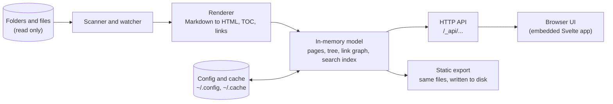
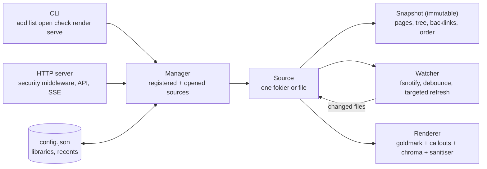

# Architecture

Docent is one executable: a command line, a local web server, a file watcher, a Markdown renderer and a search index, with the browser UI
embedded in the binary.

## Concepts

| Term | Meaning |
| ---- | ------- |
| **Source** | Any folder or single `.md` file you open. Opening is temporary: nothing is remembered. |
| **Library** | A folder you registered. It is stored in the config file and is there on the next run. A library is a source that persists. |
| **Profile** | Optional conventions for a library. `plain` (the default) needs nothing. `devnotes` adds note IDs, templates, types, commit tracking, stale-module warnings, lint and bundles. |
| **Page** | One Markdown file, rendered. Title comes from front matter, else the first heading, else the file name. |
| **Link graph** | Which pages link to which, by relative link (and by ID in the `devnotes` profile). It gives backlinks. |

## Shape

The API is a set of file-like resources, so a static export is just those resources written to disk and the same UI reads them:

| Resource | Content |
| -------- | ------- |
| `GET /_api/libraries` | Open libraries (registered and opened once) with page counts, plus the recently opened list |
| `POST /_api/libraries`, `DELETE /_api/libraries/{id}` | Register or forget a library (loopback only) |
| `POST /_api/open` | Open a folder or file for this run only (loopback only) |
| `GET /_api/tree?src=` | Folder tree: index and README first, then folders, then pages, in natural order |
| `GET /_api/page?src=&path=` | Rendered HTML, table of contents, front matter, classified links, backlinks, previous and next page, breadcrumbs, warnings |
| `GET /_api/search-index?src=` | `{"mode":"client","docs":[...]}` for small libraries, `{"mode":"server"}` for large ones (see ADR 0006) |
| `GET /_api/search?src=&q=` | Server-side search: every word must match; title, then heading, then frequency; with snippets |
| `POST /_api/drop` | Dropped Markdown files `{files:[{name,text}]}`: saved as temporary copies and opened as the `dropped` source (names must be plain `.md`/`.markdown` file names; 50 files, 5 MB each; refused in LAN mode) |
| `GET/POST /_api/share`, `GET /_api/share/qr?url=` | Sharing with a phone: status; start (`{on:true,minutes}`) or stop a read-only listener on the local network; a QR code (SVG) for an address of the running share only |
| `GET /_api/ids?q=&src=` and `GET /_id/<ID>` | Find notes by (part of) an ID: `DOC-0015`, `doc-15`, `15`, `DOC-001` (matches that start with it) or a prefix alone (the newest). `/_id/<ID>` redirects to the note, or 404 |
| `GET /_api/events` | Server-sent events: `page` (a page changed), `tree` (pages added, removed or retitled), `source` (the list of libraries changed) |
| `GET /_api/fs?dir=` | Folder picker listing with Markdown counts (loopback only, never in LAN mode) |
| `GET /_api/health` | Version and uptime |

Unknown `/_api/` paths return a JSON 404; every other path serves the UI (with `index.html` as the fallback for the app's own routes).

## Inside the core

Page addresses are `/<library>/<path without .md>`. Relative links between pages are rewritten to those addresses when a page is rendered; links to missing pages are marked
`broken`, links to other files `link-file`. Backlinks come from the same relative links.

## The developer-notes profile

A library registered with `--profile devnotes` gets conventions on top of the generic core. The core never imports the profile: `library.Hooks` (`IDPrefix`, `Validate`, `Notices`) is the whole
interface, and `internal/devnotes` implements it.

- **Layout**: `docs/<service>/<type>/<yyyy-mm-dd>-<kebab-title>.md`, `features/<feature>/<type>/`, `technologies/<technology>/guide/`. A *note* is a page whose front matter has a `date`.
- **IDs** (`PREFIX-0007`): the prefix comes from the `<x>_developer_notes` folder. The next number is `max(existing, high-water mark)+1`, where the high-water mark is kept in `~/.config/docent/ids/<library>.json` under a file lock,
  so an ID is never reused even after a note is deleted, and two processes cannot hand out the same one. IDs written in text become links (and backlinks), also across libraries.
- **Validation** (shown as warnings on the page and by `docent check`): date, title, tags (none, or listed twice), ID and prefix, folder names that look like a typo of a note type, file names, commits status and release, guide fields.
- **Views**: overview tables per service and type, "Recently updated", the tags page, and a stale banner on `module` notes whose code changed after the note (read-only `git log`).
- **Created and updated times** (`internal/library/stamps.go`, `born_linux.go`, `format.ts` `stamp`/`createdDay`): front matter holds days only. A page's `CreatedAt`/`UpdatedAt` (RFC 3339) come from the file's birth time (statx; zero on other systems) and modified time, but only when that moment falls on the front matter's day in the server's zone; otherwise they are empty and the day alone is shown. The browser formats them in its own time zone. `GET /_api/created?src=` lists every page with its creation day (a page without `date:` uses the file's birth day) for the search filter "Created", which filters in the browser so "today" is the reader's today.
- **Task lists** (`web/src/styles/app.css`): the checkbox is absolutely placed in the item's left padding. Not flex: that made every inline run (bold, code, text) of an item its own column.
- **Code wrapping** (`design/docent.css`, `enhance.ts` `syncCode`/`resetCodeWrap`, `prefs.wrapCode`): the reading setting is an attribute on `<html>` (`data-wrapcode`); a block's own button sets `data-wrap="on|off"` on that `.code`, which wins until the setting is changed again.
  The wrap button's pressed state is read back from the computed `white-space`, so CSS stays the single source of truth; a block that no longer scrolls loses its `tabindex`. Print always wraps.
- **Tables** (`web/src/lib/enhance.ts` `enhanceTables`/`layoutTables`, `tables.ts`, `TableDialog.svelte`, `design/docent.css`): the server still sends a plain `
<table>`; the page wraps it in a `.tablebox` and works out the layout in the browser, again on every resize.
  A wide table (it cannot be squeezed into the text column, or has four or more columns and would be squeezed a lot) makes its box `tablebox--wide` and the reader `reader--wide` (the table takes the whole column, text blocks stay capped at the reading width). The contents list is shown unless the reader hides it (`prefs.toc`, the top-bar switch, also in `Ctrl K`); hidden, `reader--notoc` lets a wide table use the list's column as well. A table that does not fit its box gets `.is-scroll`
  (sideways scroll, pinned first column, keyboard focus and a label, which axe requires for scrollable regions); one that fits has no scroll box, so its header can stay sticky under the top bar. Long code gets `<wbr>` after `/ . _ : , -`, which never changes the copied text.
  The enlarge button (three or more columns) opens a dialog with a copy of the table's HTML; Copy as Markdown reads the cells back, keeping code, bold, italics and links.
- **New notes** (`internal/server/latest.go`, `web/src/lib/seen.ts`, `news.svelte.ts`, `WhatsNew.svelte`): `GET /_api/latest` lists the highest-numbered notes of each library with IDs. Note IDs only go up and are never reused, so "newer" is simply a higher number,
  and the server keeps no record of the reader. The browser keeps, per library, one `base` number (everything up to it was there at the first look, or was marked seen) plus the notes above it that were opened; that is all "unseen" is.
  A live event batch re-reads the list; notes that appeared since the last read and are unseen raise the toast. Pure logic (`seen.ts`) is unit-tested; the rest is covered by `e2e/news.spec.ts`.
- **Plans** (`internal/devnotes/plan.go`, `internal/server/plan.go`, `cmd/docent/plancmd.go`, `web/src/components/PlanBoard.svelte`, `PlanList.svelte`): a `plan` note keeps its stages, steps and waiting items as a short list in the front matter.
  The core stays ignorant of it: the `Plan` hook gets the page's Markdown and returns a `PlanView` (progress, stage states worked out from the steps, now/next, waiting with ages), which the page API carries as `plan`.
  `GET /_api/plans` lists the plans in progress for the home page; `POST /_api/plan` ticks a step or clears a waiting item (refused in LAN mode, like every write).
  Plans are changed only by `devnotes.Edit`: it reads the note, applies one change under a process lock, rewrites just the `status`, `now`, `next`, `stages`, `waiting` and `updated` keys (everything else, comments included, stays byte for byte) and swaps the file in atomically.
  The status follows the work (first started step: `in-progress`; every step done: `done`; undoing a step reopens it; `dropped` is only set by hand).
- **Commands** (`cmd/docent/devnotes.go`, `notescmd.go`, `bundle.go`, `diagrams.go`): `new`, `id`, `commits`, `lint`, `stale`, `bundle`, `check --diagrams`. They are ports of the Python scripts and are tested for identical output on real notes
  (lint, stale, `commits list|pick`, ID lists and the Markdown bundle match byte for byte; the commits block keeps the Python tool's exact JSON so old notes refresh cleanly).
- **PDF and diagram checks** start a private loopback server and drive headless Chrome with `?print`, which switches off live updates (an open event stream keeps a headless page from finishing).

## The web app

A Svelte 5 single-page app (`web/`), built into `internal/ui/dist` and embedded in the binary. It reads only the API above.

- **Routes** are the page addresses: `/` (libraries), `/<library>/` (its index page, or a folder listing), `/<library>/<path>` (a page) and `/<library>/<folder>/`. Internal links are intercepted
  and navigated without a reload; the server's HTML is enhanced afterwards (copy buttons on code and sections, external links, diagrams, scrolling to a #section).
- **State** lives in small rune-based modules: libraries and trees (`app.svelte.ts`), reading preferences saved in the browser (`prefs.svelte.ts`), which overlays are open (`ui.svelte.ts`).
  Live updates arrive over server-sent events, are batched, and reload only what changed.
- **Design** is `design/tokens.css` and `design/docent.css` imported unchanged, plus `web/src/styles/app.css` for what only the real app needs.
- **Diagrams**: Mermaid 12 is bundled and loaded only on a page that has a diagram. It is themed from the design tokens (a small resolver turns `oklch()` and `color-mix()` into the plain colours Mermaid understands)
  and redrawn when the theme changes. A diagram opens enlarged over the page, or in its own window (`diagram.html`), which receives the drawing over `postMessage` so it works under the strict Content-Security-Policy.
- **Search**: a palette (Ctrl+K or `/`) for the current library or all of them. Small libraries search in the browser with MiniSearch; large ones ask the server (ADR 0006).
- **Printing**: the chooser lists the page's sections; marked sections (`{ data-no-print }`) and "Related notes" style sections are left out by default; every printed page carries an `@page` header and footer.
- **Tests**: Vitest for pure logic, and `web/e2e` (Playwright on the real binary, on a temporary copy of `testdata/fixtures/e2e`); every end-to-end test also fails on any console error.

## State

- Config: `~/.config/docent/config.json` (libraries, recents, preferences). Cache: `~/.cache/docent/<library-id>/` (index, rendered pages).
- Docent never writes into a folder you open. Any per-folder settings are optional and read from a `docent.toml` you create yourself.

## Security defaults

Binds `127.0.0.1`. `--lan` is explicit, prints a warning and makes the server read-only (no folder picker, no adding or opening folders).
Checks on every request: the Host header must be a localhost name (DNS rebinding), writes must be same-origin JSON (no cross-site forms or fetches), and a
Content-Security-Policy, no-sniff, no-framing and no-referrer headers are always sent. Only files in the page index are served, so there is no path traversal;
symbolic links are never followed. Rendered HTML passes a strict allow-list sanitiser after goldmark has already refused raw HTML. No telemetry, no network calls
except the ones you start. Access control is deliberately out of scope for now; `Server.authorize` is the one place a check can be added.
