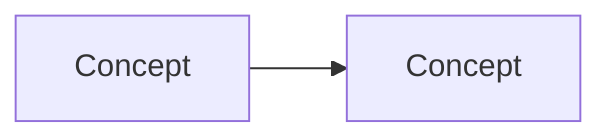

# {{title}}

!!! info "In one minute"
    **What it is:** two sentences, in plain words.

    **Why we use it:** the problem it solves for us.

    **Where:** the services that use it, with links to their notes by ID (for example DOC-0007).

**Reading paths:** new to it, start at [Beginner](#beginner-the-mental-model) · building with it, [Intermediate](#intermediate-using-it-well) ·
debugging or scaling, [Advanced](#advanced-internals-scale-and-failure-modes) · deciding or planning,
[Impact on our projects](#impact-on-our-projects) and [Similar technologies](#similar-technologies)

## Beginner: the mental model

<!-- Concepts in plain words, one idea per paragraph. Define each term once and add it to the glossary. -->



## Intermediate: using it well

<!-- The patterns and settings that matter in daily work, each with a short reason. Show the configuration we actually use. -->

## Advanced: internals, scale and failure modes

<!-- How it works underneath, what breaks under load or partial failure, how to observe and tune it. -->

## Working examples

<!-- Smallest examples that really run. Each one: what it shows, the code, how to run it, the expected result, and a Verified line. -->

### Example 1: name it

What this shows.

```ts
// minimal, complete, runnable code
```

**Run it:** the exact command.

**Expected:** what you should see.

!!! success "Verified"
    Compiled or run on YYYY-MM-DD with `package x.y.z`. Say plainly if it was only type-checked and not run.

## Real code in our services

<!-- Where this appears in the repos: service, file and what to look at. Link the notes that explain each part by ID. -->

| Service | File | What to look at |
| ------- | ---- | --------------- |
| | | |

## Impact on our projects

<!-- How this technology affects our projects in practice. Base it on the code, not on assumptions. -->

| Service | How it uses it | Version | Risk or cost |
| ------- | -------------- | ------- | ------------ |
| | | | |

- **Reliability and operations:** what it means for uptime, retries, data loss, monitoring.
- **Performance and cost:** where it helps or limits us.
- **Change and upgrade effort:** what moving versions or replacing it would involve.
- **Skills:** what a developer needs to know to work safely with it.
- **Recommendations and open decisions:** what we should do next, and what still needs an owner.

## Pitfalls and what differs by version

<!-- Mistakes people make, and behaviour that differs between the versions our services run. -->

## Similar technologies

<!-- Real alternatives, including ones that are not a drop-in replacement. Be fair: say when each one is the better choice. -->

| Option | What it is | Prefer it when | Avoid it when | Effort to switch from this |
| ------ | ---------- | -------------- | ------------- | -------------------------- |
| | | | | |

## Check your understanding

<!-- Four to six questions that test real understanding, each with a short answer. -->

??? question "Question"
    Answer.

## Further reading

<!-- Only sources that were opened or found through search while writing this. Say why each is worth reading. -->

| Resource | Type | Level | Why read it | Accessed |
| -------- | ---- | ----- | ----------- | -------- |
| | | | | {{date}} |

## Glossary

Term
:   Plain-words definition.
