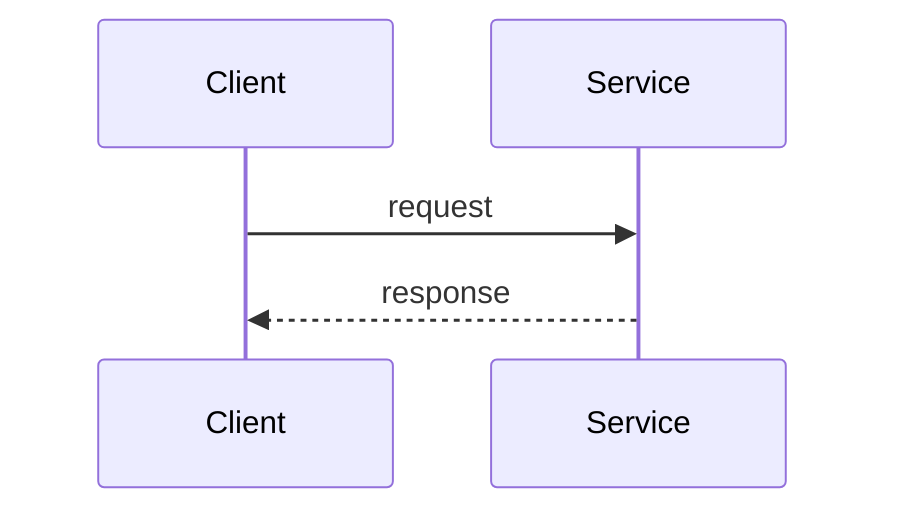

# {{title}}

!!! info "Summary"
    One or two sentences: what was built or changed, and why.

## Context

Why this was needed (ticket, bug, requirement). Link related notes if any.

## What changed

| File | Change |
| ---- | ------ |
| `src/...` | ... |

## Flow



## Key decisions

1. **Chose X over Y** because ...

## API, config and environment changes

- None / list new endpoints, env vars, DB fields, Kafka topics.

## QA checklist

- [ ] ...

## Rollback

How to revert safely (and any data/migration caveats).

## Commit message

```text
type(scope): brief description
```

## Follow-ups

- ...
