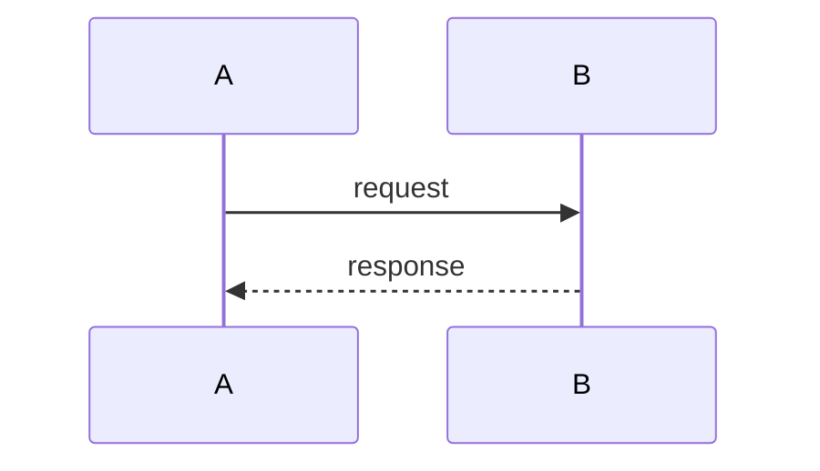

# {{title}}

!!! info "What it does"
    A few sentences: what this module does for the business, and who uses it (users, admins, other services).
    A living note: one per module, updated in place (set `updated:`), never replaced by a new one.

<!-- 1. What it does: who uses it and for what. Short; the details are in the sections below. -->

## How it works

<!-- 2. Mermaid flows for the main paths (sequenceDiagram for request/response, flowchart for decisions). One idea per diagram. -->

## Rules

<!-- 3. Each rule linked to its decision (an ADR or note ID) and to its story or ticket, where there is one. -->

| Rule | Decision | Story |
| ---- | -------- | ----- |
| ... | ... | ... |

## Data

<!-- 4. Tokens, claims, collections and events the module uses, with the fields that matter. -->

## Interfaces

<!-- 5. Routes, Kafka topics, jobs and other interfaces; link the API notes for exact contracts. -->

| Interface | Kind | Purpose | Contract |
| --------- | ---- | ------- | -------- |
| ... | route / topic / job | ... | DOC-xxxx |

## Where it lives

<!-- 6. Services, files and configuration keys. -->

| What | Where |
| ---- | ----- |
| ... | ... |

## Status by stage

<!-- 7. What is built and what is open, by stage, release or milestone. -->

| Stage | Built | Open |
| ----- | ----- | ---- |
| 1 | ... | ... |

## How it is tested

<!-- 8. Unit, integration and environment tests, with links to the results. -->

## Open questions

<!-- 9. Undecided points, each with who decides. -->

## Future improvements

<!-- 10. Ideas beyond the current plan, each with why and when it would matter. -->

## Related notes

- ...
