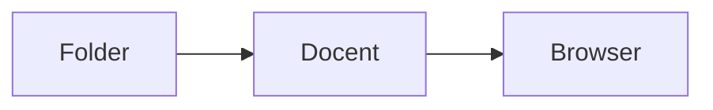

# Syntax tour

Every Markdown feature Docent supports appears once on this page, so a renderer test can check them all.

## Text

Plain paragraph with **bold**, *italic*, ~~strikethrough~~, `inline code` and a [link](getting-started.md).

> A block quote.

## Lists

1. First
2. Second
   - nested item
   - another

- [x] done task
- [ ] open task

Term
:   The definition of the term.

## Admonitions

!!! note "A note"
    Content of the note, indented four spaces.

!!! warning
    A warning without a custom title.

> [!TIP]
> GitHub style alerts are supported too.

??? info "Collapsed by default"
    Hidden until opened.

???+ question "Open by default"
    Visible at first.

## Table

| Route | Purpose |
| ----- | ------- |
| `GET /a` | First |
| `POST /b` | Second |

## Code

```typescript
export const answer: number = 42;
```



## Attributes and footnotes { #custom-id .highlight }

A sentence with a footnote.[^1]

[^1]: The footnote text.

## Not supported in v1

 is rendered as its alt text only.
